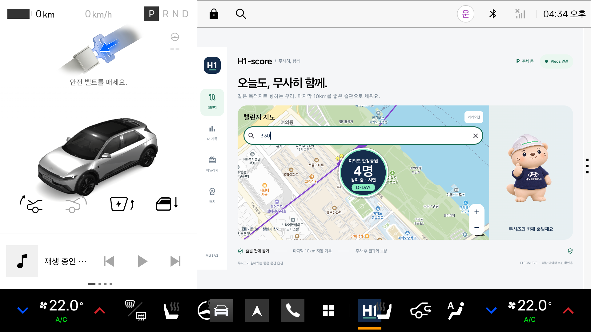
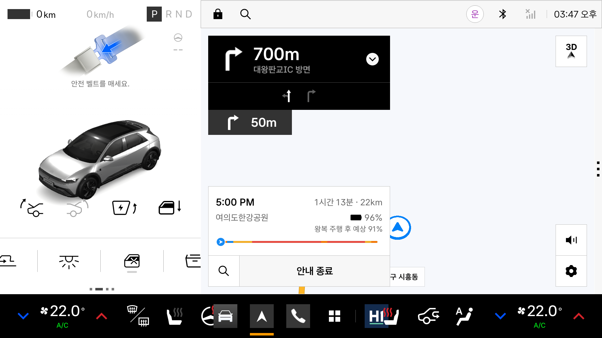
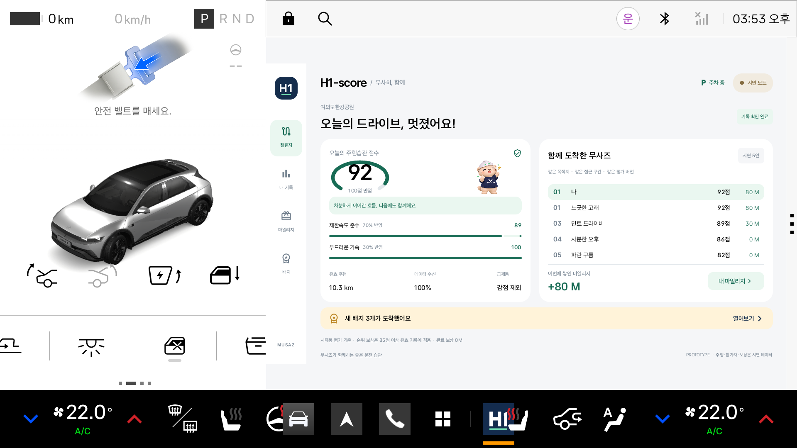

# H1-score · 무사즈

**오늘도, 무사히 함께.** 같은 목적지로 향하는 운전자들이 마지막 10km의 주행 습관을 비교하고, 주차 후 점수·순위·마일리지·배지를 확인하는 Pleos 차량용 앱 프로토타입입니다.

[실행 안내](docs/prototype/START-HERE.md) · [카카오맵 설정](docs/prototype/ENVIRONMENT.md) · [시연 영상 MP4](docs/media/demo-walkthrough.mp4) · [SDK와 점수 구현](docs/prototype/IMPLEMENTATION.md)

## 화면 흐름

영상은 아래 에뮬레이터 캡처를 순서대로 묶은 21초 요약입니다. Pleos 내장 내비 화면과 시연용 주행·결과 화면을 구분했습니다.

| 단계 | 화면 | 운전자가 하는 일 |
| --- | --- | --- |
| 1 | [챌린지 지도](docs/media/01-challenge-map.png) | 목적지를 검색하고 지도 위 챌린지 마커에서 참가 인원과 마감 정보를 확인합니다. 마커를 선택하고 주차 상태에서 참가에 동의합니다. |
| 2 | [Pleos 내장 내비](docs/media/02-pleos-navigation.png) | 선택한 목적지로 내장 내비 길 안내를 시작합니다. 캡처에서는 여의도한강공원 안내가 시작됐습니다. |
| 3 | [10km 구간 기록](docs/media/03-demo-recording.png) | 참가 예약 후 내비 경로의 남은 거리가 10km에 들어오면 기록을 시작하는 흐름입니다. 이 캡처는 시연 모드입니다. |
| 4 | [도착과 주차 확인](docs/media/04-demo-arrival.png) | 도착 후 주차가 확인되면 결과를 열 수 있습니다. 시연 모드에서 재현한 화면입니다. |
| 5 | [안전운전 점수와 순위](docs/media/05-demo-results.png) | 점수, 순위, 적립 마일리지를 확인합니다. 영상 예시는 92점·공동 1위·80M입니다. |
| 6 | [신규 배지](docs/media/06-demo-badge.png) | 새 배지를 열 때 금색 방패를 든 무사즈를 만납니다. 마일리지 탭에서 정비 혜택 예시와 필요 M을 확인할 수 있습니다. |

<p>
  
  
  
  
</p>

## 어떤 데이터가 어디에 쓰이나요?

| 구분 | 역할 |
| --- | --- |
| Kakao Maps Android SDK | 챌린지 탐색 지도와 목적지 마커 |
| Pleos NaviHelper | 내장 내비 안내 요청, 목적지와 남은 거리 등 내비 데이터 |
| Pleos Vehicle / AAOS | 지원·권한이 확인된 차량 상태와 속도 입력 |
| Kotlin 점수 엔진 | 주행 입력을 검증하고 점수·시연 순위·마일리지·배지를 계산 |
| 시연 데이터 | 가상의 참가자·순위 및 정비 혜택을 재현 |

Pleos 에뮬레이터에서 내장 내비 길 안내 시작을 확인했습니다. 이번 내비 경로 재생에서는 남은 거리 갱신과 도착 콜백까지 확인하지 못했습니다. 주행·도착·순위·마일리지의 전체 화면 흐름은 앱의 시연 모드에서 재현합니다. 실시간 차량 매칭 서버와 실제 정비 교환은 후속 구현 범위입니다.

## 실행과 검증

1. 저장소를 복제하고 Android Studio에서 `android/`을 엽니다.
2. 실제 지도 표시가 필요하면 [카카오맵과 로컬 설정](docs/prototype/ENVIRONMENT.md)을 적용합니다.
3. 실행 대상에 Pleos Connect Emulator를 선택하고 `app`을 실행합니다.
4. 점수와 보상 흐름을 재현할 때는 [시연 안내](docs/prototype/START-HERE.md)를, 차량 상태를 조작할 때는 [Virtual Console 가이드](https://document.pleos.ai/docs/connect/guide/getting-started/application-development/use-vehicle-emulator)를 참고합니다.

```bash
cd android
./gradlew :core:test :app:assembleDebug
```

### Virtual Console로 급가감속과 점수 확인

**디버그 빌드의 에뮬레이터에서만** 사용할 수 있습니다. 기존 주행·결과 화면을 그대로 사용하며, 차량 차속과 원본 timestamp는 실제 `CarPropertyManager` 입력을 받습니다. 제한속도와 벨트 착용은 명시적인 시험 조건으로 대체하므로 내비 목적지·도착 이벤트나 참가 시간을 기다리지 않아도 됩니다.

1. Pleos 에뮬레이터를 실행하고 `adb forward tcp:8088 tcp:8088` 후 [Virtual Console](http://127.0.0.1:8088/)을 엽니다.
2. H1 앱의 **Pleos 연결 → 프로토타입 제어**에서 시험 제한속도 **50 / 80 / 100km/h**를 선택하고 **콘솔 입력 테스트 시작**을 누릅니다. 시작은 P단·0km/h에서만 가능합니다.
3. 콘솔에서 **D → ACCEL을 누르고 있기 → BRAKE를 누르고 있기**로 주행합니다. Pleos가 주행 중 앱 화면을 잠가도 기록은 이어집니다.
4. **정지 → P단**으로 돌아오면 기존 주행 화면에서 급가속·급감속 건수와 가점을 확인합니다. **시험 종료 · 결과 보기 → 1km별 가점 보기**에서 구간별 가점, 사건별 가속도와 브레이크 확인 여부를 확인합니다.
5. 짧은 시험은 소수점 **시험 누적 점수**로 비교합니다. 최종 정수 점수는 기존대로 유효 주행 500m 이상, 평가 자료 90% 이상, 가감속 실제 수신 8Hz 이상 등의 조건을 충족해야 확정됩니다. 9km 조건은 순위용 유효 기록 조건이며, 콘솔 시험에서는 순위·마일리지·배지를 지급하지 않습니다.

급가속 +2.5m/s² 이상 1초, 급감속 최근 1초 평균 −3m/s² 이하, 같은 종류의 사건 2초 이내 병합 기준은 유지합니다. 점수도 **60 + 제한속도 준수 거리(km)×2.5 + 부드러운 가감속 거리(km)×1.5 − 회전 감점**, 최대 10km·100점으로 동일합니다. 콘솔 시험은 급가감속 검증에 집중하며 회전 감점은 수집하지 않습니다. 급가감속 건당 추가 감점은 없고, 확정 구간의 가감속 가점만 제외합니다. 선택한 시험 제한속도를 넘으면 해당 구간의 두 가점이 모두 제외됩니다.

주행 중에는 Android Studio Logcat에서 `tag:H1Console`을 검색하거나 `adb logcat -s H1Console:D '*:S'`로 건수·가점·수신 Hz를 확인할 수 있습니다. 기록 표본 수신 중 약 500ms마다 집계하며, `limit=…(test) belt=assumed`로 시험 조건을 표시합니다. 정확한 1초 경계 검증은 자동 테스트를 사용합니다. [검증 절차와 범위](docs/prototype/QA.md#11월-7일--virtual-console-입력-시험)

콘솔 시험에서는 속도 구독을 20Hz로 요청하며 차량이 지원하는 최대 빈도로 제한합니다. 일반 모드의 요청은 10Hz로 유지합니다. 요청값은 실제 수신 빈도를 보장하지 않으므로 결과 화면의 측정 Hz를 확인하세요. 수신값을 복제하거나 시간 간격을 합성하지 않으며 기존 8Hz 품질 조건도 그대로 적용합니다.

## 폴더 구조

```text
android/app/      Compose 화면, 카카오맵과 Pleos 어댑터, 앱 리소스
android/core/     점수·마일리지·배지 로직과 JVM 단위 테스트
docs/prototype/   실행 환경, UX, 구현 범위, 검증 기록
docs/media/       에뮬레이터 캡처와 영상 요약
mascots/          무사즈 원본 이미지와 앱용 표정
scripts/          로컬 검증과 소스 패키징
sources/          마스코트 제작 자료
index.html        기획과 마스코트 모음
```

- [주제 구체화](docs/주제-구체화.md) · [UX와 마스코트](docs/prototype/DESIGN.md) · [검증 기록](docs/prototype/QA.md)
- 구조 레퍼런스는 Google의 [Now in Android](https://github.com/android/nowinandroid)와 [Android Architecture Samples](https://github.com/android/architecture-samples)입니다. 이 저장소는 Android 앱과 독립적으로 테스트할 수 있는 점수 모듈을 나누고, 실행 문서와 시연 자료를 별도로 관리합니다.


### 점수 정책 변경 · v0.2 가점제

시작 60점에 실제 주행 1km당 제한속도 준수 최대 +2.5점, 부드러운 가감속 최대 +1.5점을 합산합니다. 최대 10km·100점이며 짧은 주행을 만점으로 환산하지 않습니다. 결과 화면의 '1km별 가점 보기'에서 계산 근거를 확인할 수 있습니다. 실제 모드 예약·기록 중 운전석 벨트 미착용이 확인되면 해당 세션은 실격되고 보상 대상에서 제외됩니다. 상세 정책은 IMPLEMENTATION.md를 참고하세요. 기존 캡처·영상의 92점은 이전 점수 정책 기준입니다.

GPS·NaviHelper 좌우회전 안내·앞바퀴 조향각·방향지시등을 함께 확인한 회전은 미사용 −1점, 반대 신호 −2점(주행당 최대 −10점)을 반영합니다. 정확도 부족·센서 누락·주차/후진·회전 안내 없는 곡선도로에는 감점을 확정하지 않습니다.

가감속은 차량 원본 timestamp로 판정합니다. `longitudinal-v2`에서 급가속은 기존대로 최근 세 구간 가속도의 중앙값이 +2.5m/s² 이상으로 1초 지속될 때 확정합니다. 급감속은 **직전 1초의 원시 속도 차이 ÷ 1초가 −3m/s² 이하**이면 확정하며, 추가 지속 시간은 요구하지 않습니다. 예를 들어 1초 동안 72→61.2km/h이면 급감속에 해당합니다. 급감속 가점 제외는 해당 창 안에서 실제 속도가 감소한 구간에만 적용합니다. 건당 추가 감점은 없으며, 같은 종류의 사건은 유효 데이터가 이어질 때 2초 이내 간격으로 병합하고 사이 정상 구간의 가점은 유지합니다. 저주파·누락 입력은 정상 주행으로 간주하지 않습니다. [상세 기준과 근거](docs/prototype/IMPLEMENTATION.md#급가속급감속-검출-longitudinal-v2)를 참고하세요.
