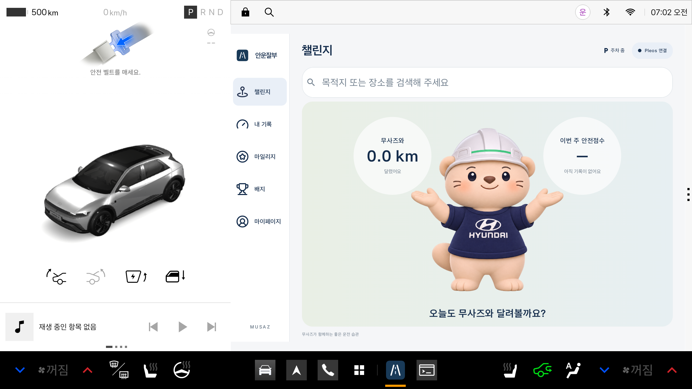
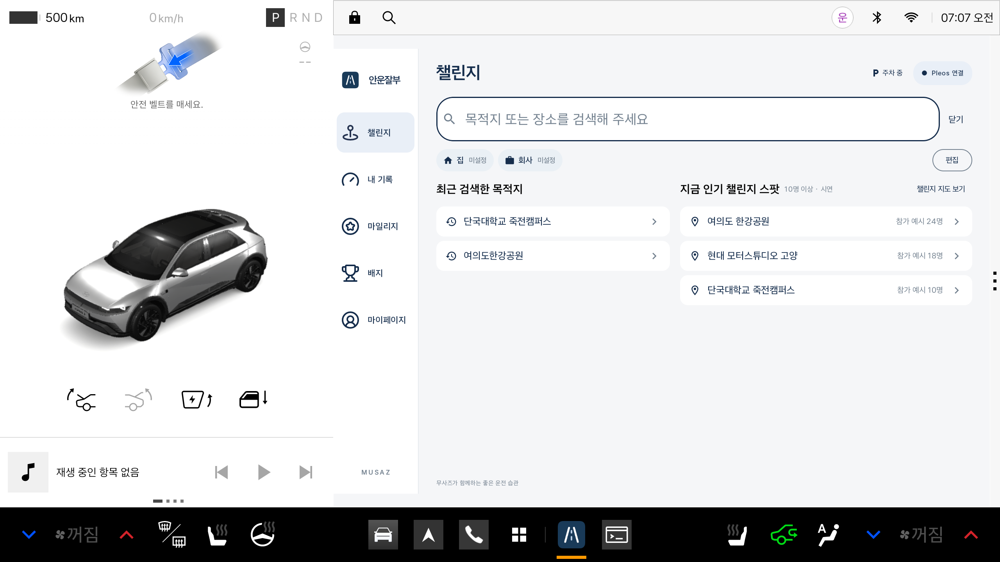
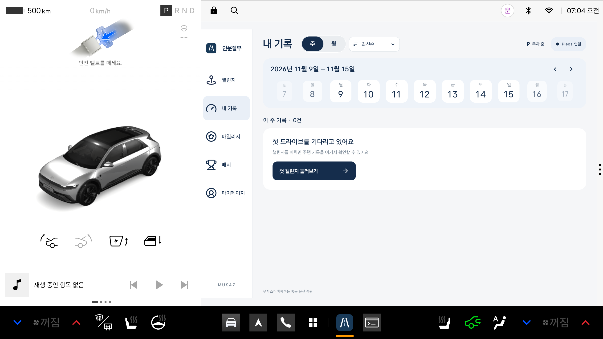
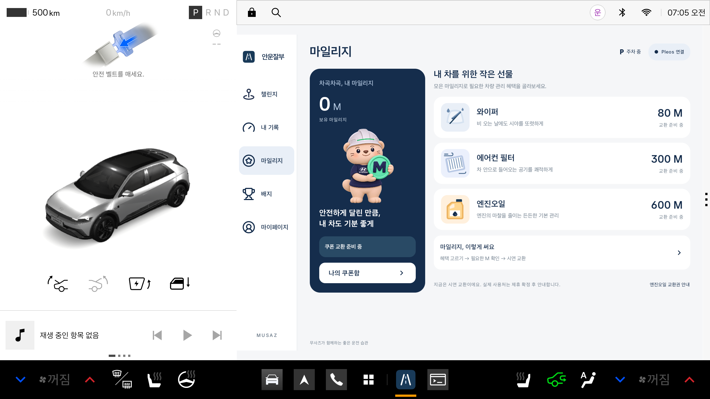
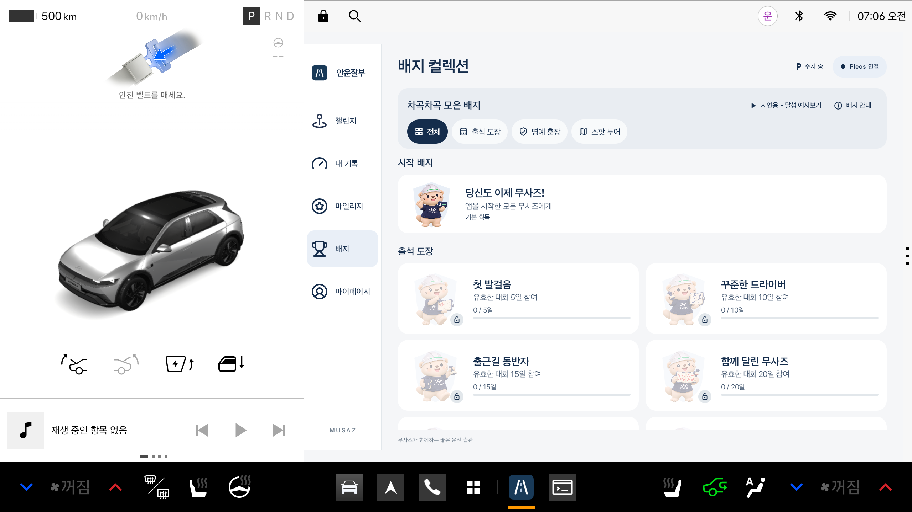
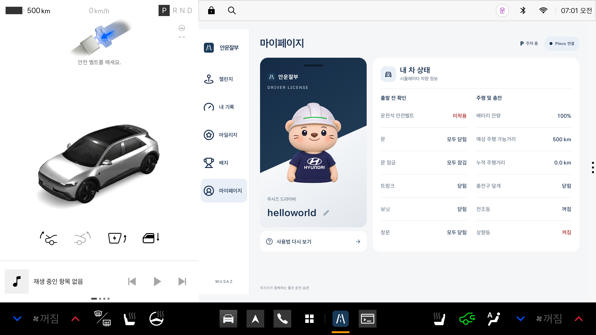

# 안운잘부 · 무사즈

**안전운전 잘 부탁드립니다.** 목적지 주변의 챌린지에 참여하고, 도착 후 자신의 운전 습관을 돌아보며 마일리지와 배지를 모으는 Pleos 차량용 앱입니다.

같은 목적지 권역으로 향하는 운전자들이 안전운전 점수로 선의의 경쟁을 하고, 안전하게 달린 경험이 다음 주행의 동기가 되는 서비스를 제안합니다. 현재 저장소는 차량·내비게이션 연동과 주행 평가, 기록 조회, 시연 보상 흐름을 구현한 Android 프로토타입입니다.

[실행 안내](docs/prototype/START-HERE.md) · [카카오맵 설정](docs/prototype/ENVIRONMENT.md) · [이용 규칙 및 구현 명세](docs/specifications/안운잘부-이용규칙-및-구현명세.md) · [기존 시연 영상](docs/media/demo-walkthrough.mp4)

## APK 다운로드 및 파일 위치

**[제출 APK 다운로드 · MUSAZ_Anwunjalbu_release.apk](https://github.com/DKU-MUSAZ/h1-score/releases/download/contest-submission/MUSAZ_Anwunjalbu_release.apk)**

- **GitHub Release:** [contest-submission](https://github.com/DKU-MUSAZ/h1-score/releases/tag/contest-submission)
- **직접 빌드한 Debug APK 위치:** `android/app/build/outputs/apk/debug/app-debug.apk` (저장소 루트 기준)
- Debug APK는 아래 빌드 명령으로 생성되는 로컬 파일입니다. 다운로드하려면 위 Release 첨부 파일을 사용하세요.



## 왜 안운잘부인가요?

운전자는 자신의 운전에서 무엇이 좋았고 무엇을 개선해야 하는지 구체적으로 돌아볼 기회가 많지 않습니다. 안운잘부는 주행 후 피드백을 운전의 오답노트처럼 제공하고, 챌린지와 수집 요소로 안전운전을 꾸준히 실천할 동기를 만들고자 합니다.

- **운전 습관을 돌아봅니다.** 제한속도 준수와 급가감속, 방향지시등 사용 등 주행 데이터를 바탕으로 피드백을 제공합니다.
- **일상의 이동을 참여로 연결합니다.** 통학·출퇴근·외근 목적지 주변에서 챌린지를 찾고, 같은 개최지와 회차를 기준으로 비교하도록 설계했습니다.
- **작은 성취를 쌓습니다.** 출석 도장, 명예 훈장, 스팟 투어 배지로 참여와 방문의 목표를 제공합니다.
- **차량 관리로 이어집니다.** 적립 마일리지를 차량 관리 쿠폰에 사용하는 것이 서비스 목표입니다. 현재 교환은 시연 범위이며 실제 정비소 사용은 후속 연동입니다.

## 이용 흐름

**출발 전 목적지 선택 → 챌린지 참가 → 마지막 10km 평가 → 도착·주차 → 피드백 확인 → 기록·배지·마일리지**

| 단계 | 사용자가 하는 일 | 앱의 역할 |
| --- | --- | --- |
| 출발 전 | 목적지 검색, 참가 조건 확인 | 목적지 반경 1km 안에서 가장 가까운 등록 개최지를 연결합니다. |
| 참가 | 주차 상태와 운전석 벨트 확인, 참가 동의 | 내비 경로를 확인하고 참가를 확정합니다. |
| 주행 | 평소처럼 안전하게 운전 | 남은 경로가 10km에 들어오면 기록을 시작하고 차량·내비 정보를 평가합니다. |
| 도착 후 | 목적지 도착 후 주차 | 주행 결과를 준비하고 주차 후 확인할 수 있도록 합니다. |
| 돌아보기 | 내 기록에서 결과 확인 | 점수와 운전 습관 피드백, 결과 인정 여부를 보여줍니다. |
| 다음 참여 | 배지 목표와 마일리지 확인 | 누적된 성과를 다음 안전운전의 동기로 연결합니다. |

주행 중 상세 조작은 차량의 UX 제한과 주차 상태에 따라 제한합니다. 목적지 근처에 챌린지가 없으면 일반 길 안내로 연결하는 흐름을 제공합니다.

## 실제 실행 화면

아래는 **일반 Pleos 연결 모드**의 현재 실행 화면입니다. 주행 기록과 마일리지가 없는 상태이며, 검색 화면의 참가 인원은 화면에 표시된 것처럼 시연 예시입니다. 왼쪽 차량 그림과 하단 조작부는 Pleos 시스템 UI이고 오른쪽이 안운잘부 앱입니다. 이미지를 클릭하면 원본 크기로 볼 수 있습니다.

### 챌린지와 목적지 검색

누적 주행거리와 이번 주 안전점수를 확인하고, 최근 목적지·집·회사 바로가기·인기 챌린지 스팟에서 다음 이동을 준비합니다.

<p>
  <a href="docs/media/readme/01-home.png"></a>
  <a href="docs/media/readme/06-search.png"></a>
</p>

### 내 기록과 마일리지

내 기록은 주·월 달력과 정렬 기능으로 주행을 찾아보는 화면입니다. 현재 캡처에는 저장된 주행이 없어 첫 챌린지를 안내합니다. 마일리지는 보유 잔액, 차량 관리 혜택과 나의 쿠폰함을 제공합니다.

<p>
  <a href="docs/media/readme/02-history.png"></a>
  <a href="docs/media/readme/03-mileage.png"></a>
</p>

### 배지와 마이페이지

배지는 출석 도장·명예 훈장·스팟 투어로 구성합니다. 마이페이지는 운전자 프로필과 함께 차량 상태를 ‘출발 전 확인’, ‘주행 및 충전’으로 나누어 보여줍니다. 차량 신호는 지원 여부와 수신 상태에 따라 표시합니다.

<p>
  <a href="docs/media/readme/04-badges.png"></a>
  <a href="docs/media/readme/05-profile.png"></a>
</p>

## 안전운전 평가

기획서의 평가 대상은 제한속도, 방향지시등, 급가속, 급감속, 안전벨트입니다. 차량과 내비게이션에서 받은 정보를 검증한 뒤 점수와 결과에 반영합니다.

현재 점수 엔진은 **기본 60점 + 거리 기반 가점 − 회전 관련 감점** 구조입니다. 제한속도 준수는 km당 최대 2.5점, 부드러운 주행은 km당 최대 1.5점을 적립하며, 평가 거리는 최대 10km입니다. 급가감속이 확인된 구간이나 유효한 입력을 확보하지 못한 구간의 처리에는 별도 조건이 적용됩니다.

안전벨트 미착용과 필수 신호 확인 불가, 시간 초과 등은 단순한 점수 차이와 구분하여 결과 인정 여부에 반영합니다. 회전 평가는 GPS·내비 회전 안내·조향·방향지시등을 교차 확인하며, 불확실한 신호를 확정 위반으로 취급하지 않도록 설계했습니다.

자세한 구현은 [점수 엔진](android/core/src/main/kotlin/ai/musaz/h1score/core/ChallengeRules.kt)과 [이용 규칙 명세](docs/specifications/안운잘부-이용규칙-및-구현명세.md)를 참고하세요. 실차에서 효과를 검증한 안전성 지표나 사고 예방 성과를 의미하지 않습니다.

## 차량 특화 구현

```text
차량 신호 + 내비게이션 + GPS
              ↓
     신호 유효성·최신성 확인
              ↓
   참가 조건·주행 이벤트·점수 판정
              ↓
     결과 저장과 주차 후 피드백
              ↓
       기록·배지·마일리지
```

| 구성 | 활용 |
| --- | --- |
| Kotlin · Jetpack Compose | 차량 화면과 상태 기반 UI |
| ViewModel · StateFlow | 참가·기록·도착·결과 화면 상태 관리 |
| Android Automotive 차량 속성 API | 차량 속도·기어 등 주행 입력 |
| Pleos Vehicle SDK | 안전벨트·조향·방향지시등 및 차량 상태 조회 |
| Pleos NaviHelper SDK | 목적지·남은 거리·도로 제한속도·회전 안내·도착 이벤트 |
| Android LocationManager | GPS 위치·진행방향·정확도 |
| Kakao Maps SDK · Local REST API | 지도와 장소 검색 |
| CarUxRestrictionsManager | 주행 중 조작 제한 |
| Pleos TextToSpeech · Android 알림 | 기록 관련 음성 안내와 완료 알림 |
| Kotlin core · SharedPreferences | 판정 로직, 주행 기록과 보상 이력의 로컬 저장 |

## 현재 구현 범위와 다음 단계

| 구분 | 현재 프로토타입 | 후속 개발 |
| --- | --- | --- |
| 챌린지 | 등록 개최지와 목적지 매칭, 회차·참가 조건·기록 상태 관리 | 실제 사용자 매칭, 서버 기준 참가 제한 |
| 주행 평가 | 차량·내비 입력, 점수 엔진, 결과 저장과 피드백 | 실차 환경별 신호·판정 정확도 검증 |
| 순위와 보상 | 시연 참가자 비교와 로컬 보상 처리 | 회차 종료 후 서버 순위 확정·지급 원장 |
| 마일리지 | 혜택 안내, 시연 교환과 쿠폰함 | 실제 쿠폰 발행·사용 인증·제휴 정비소 연동 |
| 배지 | 출석·명예·스팟 분류와 진행 상황 | 서버 확정 순위 및 제휴처 방문 인증 연동 |
| 사용처 탐색 | 현재 위치 기반 탐색 설계 문서 | 제휴 매장 데이터·위치 기반 조회·거리순 정렬 |
| 평가 확장 | 차량 신호 중심 평가 | 카메라 기반 차선 변경·안전거리 평가 연구 |

[현재 위치 기반 마일리지 사용처 탐색 설계](android/docs/design/mileage-nearby-redemption-plan.md)

현재 위치를 기준으로 찾는 마일리지 사용처와 **목적지**를 기준으로 매칭하는 챌린지 개최지는 서로 다른 기능입니다. 주변 정비소 탐색이 이미 동작하는 기능으로 오해되지 않도록 구현 범위를 명시합니다.

## 테스트 환경 및 필요한 설정

개발 및 실행 화면 캡처에 사용한 환경입니다. 에뮬레이터의 AVD 이름과 시스템 빌드 정보, `adb shell wm size`·`wm density`로 확인했습니다.

| 항목 | 사용 환경 |
| --- | --- |
| 개발 OS | Windows · Android Studio |
| Pleos Connect 에뮬레이터 버전 | **v2.1.0** (AVD: `Pleos_Connect_v2.1.0`) |
| 시스템 빌드 | `RELEASE.release_connect_v2.1.0 test-keys` |
| Android / CPU | Android 14 (API 34) / x86_64 |
| 화면 규격 | **2560 × 1440 px, 가로형 16:9, 160 dpi** |
| 화면 범위 | 차량 패널·하단 시스템 UI를 포함한 전체 디스플레이 기준. 앱은 오른쪽 앱 영역에 표시 |
| 빌드 환경 | JDK 21, Gradle Wrapper 8.11.1, Android SDK Platform 35 |
| 앱 SDK 설정 | compileSdk 35 / targetSdk 34 / minSdk 28 |
| Pleos SDK | Vehicle 2.3.2 / NaviHelper 3.0.5 / TextToSpeech 3.3.1 |

소스에서 빌드할 때는 `android/local.properties`의 `sdk.dir`을 자신의 Android SDK 경로로 설정합니다. 실제 지도와 일반 장소 검색을 테스트하려면 다음 설정이 필요합니다.

| 설정 | 용도 |
| --- | --- |
| `KAKAO_NATIVE_APP_KEY` | 카카오 지도 표시용 네이티브 앱 키 |
| `KAKAO_LOCAL_REST_API_KEY` | 내부 검증용 Debug 빌드의 일반 장소 검색 |
| 카카오 Android 앱 등록 | 패키지명 `ai.musaz.h1score`와 설치할 APK의 서명 키 해시 등록 |
| 네트워크·위치 | 에뮬레이터 인터넷 연결, 위치 기능 활성화 및 앱의 위치 권한 허용 |
| 챌린지 참가 조건 | Pleos 차량 신호 연결, 주차(P) 상태와 운전석 안전벨트 착용 확인 |

실제 키는 저장소에 올리지 않고 로컬에서 설정합니다. 상세 설정과 키가 없는 경우의 동작은 [환경 설정 안내](docs/prototype/ENVIRONMENT.md)를 참고하세요.

## 실행 방법

### 배포 APK로 실행

1. 위 Release에서 `MUSAZ_Anwunjalbu_release.apk`를 다운로드합니다.
2. Android Studio의 Device Manager에서 **Pleos Connect v2.1.0** 에뮬레이터를 실행합니다.
3. APK를 받은 폴더에서 다음 명령으로 설치합니다. `adb`는 Android SDK Platform-Tools에 포함됩니다.

```text
adb devices
adb install -r "MUSAZ_Anwunjalbu_release.apk"
```

4. Pleos 앱 목록에서 **안운잘부**를 실행하고 최초 안내와 필요한 권한 설정을 진행합니다. 기기가 여러 대 연결되어 있으면 `adb -s <기기 ID> install -r ...`로 대상을 지정합니다.

### 소스에서 빌드·실행

1. Android Studio에서 저장소의 `android/` 폴더를 엽니다.
2. Android SDK와 프로젝트 의존성을 준비하고 Gradle Sync를 실행합니다.
3. [로컬 환경 설정](docs/prototype/ENVIRONMENT.md)에 따라 카카오 키와 Android 앱 등록 정보를 설정합니다.
4. Pleos Connect 에뮬레이터를 켜고 `app`을 빌드·실행합니다.
5. 처음 실행하면 소개·데이터 이용 안내·닉네임·기능 안내를 진행합니다. 이후 마이페이지의 **사용법 다시 보기**에서 기능 안내를 다시 볼 수 있습니다.

Windows PowerShell에서 빌드:

```powershell
cd android
.\gradlew.bat :core:test :app:assembleDebug
```

macOS·Linux에서 빌드:

```bash
cd android
./gradlew :core:test :app:assembleDebug
```

빌드 완료 후 Android Studio의 Run 버튼으로 실행하거나, 저장소 루트에서 다음 명령으로 Debug APK를 설치한 뒤 Pleos 앱 목록에서 **안운잘부**를 실행합니다.

```text
adb install -r android/app/build/outputs/apk/debug/app-debug.apk
```

### 차량 신호 조작 및 테스트

Pleos Virtual Console:

```text
adb forward tcp:8088 tcp:8088
http://127.0.0.1:8088/
```

문서에 사용한 앱 버전은 빌드·설치·홈 실행을 확인했습니다. 이번 README 작업에서는 메뉴 화면을 직접 확인하고 캡처했으며, 전체 자동 테스트나 실제 차량 주행을 새로 수행하지 않았습니다. 기존 시연 영상은 이전 버전 자료로, 위 최신 캡처와 UI가 다를 수 있습니다.

## 프로젝트 구조

```text
android/app/         Compose 화면, 차량·내비 연동, 기록 저장
android/core/        점수·참가·배지·마일리지 판정과 단위 테스트
android/docs/       구현 설계와 PR별 화면 자료
docs/prototype/     실행 환경과 시연 안내
docs/specifications/ 이용 규칙과 구현 명세
docs/media/         기존 시연 영상과 화면 자료
```

