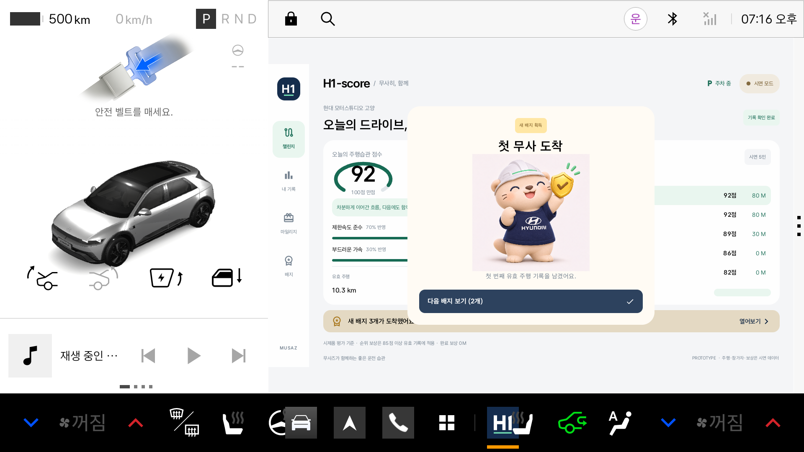

# 안운잘부 · 무사즈

**안전운전 잘 부탁드립니다.** 같은 목적지로 향하는 운전자들이 마지막 10km의 주행 습관을 비교하고, 주차 후 점수·순위·마일리지·배지를 확인하는 Pleos 차량용 앱 프로토타입입니다.

[실행 안내](docs/prototype/START-HERE.md) · [카카오맵 설정](docs/prototype/ENVIRONMENT.md) · [시연 영상 MP4](docs/media/demo-walkthrough.mp4) · [SDK와 점수 구현](docs/prototype/IMPLEMENTATION.md)

## 화면 흐름

영상은 아래 에뮬레이터 캡처를 순서대로 묶은 21초 요약입니다. 촬영 당시 앱 이름과 아이콘이 화면에 남아 있습니다. Pleos 내장 내비 화면과 시연용 주행·결과 화면을 구분했습니다.

| 단계 | 화면 | 운전자가 하는 일 |
| --- | --- | --- |
| 1 | [챌린지 지도](docs/media/01-challenge-map.png) | 목적지를 검색하고 지도 위 챌린지 마커에서 참가 인원과 마감 정보를 확인합니다. 마커를 선택하고 주차 상태에서 참가에 동의합니다. |
| 2 | [Pleos 내장 내비](docs/media/02-pleos-navigation.png) | 선택한 목적지로 내장 내비 길 안내를 시작합니다. 캡처에서는 여의도한강공원 안내가 시작됐습니다. |
| 3 | [10km 구간 기록](docs/media/03-demo-recording.png) | 참가 예약 후 내비 경로의 남은 거리가 10km에 들어오면 기록을 시작하는 흐름입니다. 이 캡처는 시연 모드입니다. |
| 4 | [도착과 주차 확인](docs/media/04-demo-arrival.png) | 도착 후 주차가 확인되면 결과를 열 수 있습니다. 시연 모드에서 재현한 화면입니다. |
| 5 | [안전운전 점수와 순위](docs/media/05-demo-results.png) | 점수, 순위, 적립 마일리지를 확인합니다. 영상 예시는 92점·공동 1위·80M입니다. |
| 6 | [신규 배지](docs/media/06-demo-badge.png) | 새 배지를 열 때 금색 방패를 든 무사즈를 만납니다. 마일리지 탭에서 정비 혜택 예시와 필요 M을 확인할 수 있습니다. |

<p>
  
  
  
  
</p>

## 어떤 데이터가 어디에 쓰이나요?

| 구분 | 역할 |
| --- | --- |
| Kakao Maps Android SDK | 챌린지 탐색 지도와 목적지 마커 |
| Pleos NaviHelper | 내장 내비 안내 요청, 목적지와 남은 거리 등 내비 데이터 |
| Pleos Vehicle / AAOS | 지원·권한이 확인된 차량 상태와 속도 입력 |
| Kotlin 점수 엔진 | 주행 입력을 검증하고 점수·시연 순위·마일리지·배지를 계산 |
| 시연 데이터 | 가상의 참가자·순위 및 정비 혜택을 재현 |

Pleos 에뮬레이터에서 내장 내비 길 안내 시작을 확인했습니다. 이번 내비 경로 재생에서는 남은 거리 갱신과 도착 콜백까지 확인하지 못했습니다. 주행·도착·순위·마일리지의 전체 화면 흐름은 앱의 시연 모드에서 재현합니다. 실시간 차량 매칭 서버와 실제 정비 교환은 후속 구현 범위입니다.

## 실행과 검증

1. 저장소를 복제하고 Android Studio에서 `android/`을 엽니다.
2. 실제 지도 표시가 필요하면 [카카오맵과 로컬 설정](docs/prototype/ENVIRONMENT.md)을 적용합니다.
3. 실행 대상에 Pleos Connect Emulator를 선택하고 `app`을 실행합니다.
4. 점수와 보상 흐름을 재현할 때는 [시연 안내](docs/prototype/START-HERE.md)를, 차량 상태를 조작할 때는 [Virtual Console 가이드](https://document.pleos.ai/docs/connect/guide/getting-started/application-development/use-vehicle-emulator)를 참고합니다.

```bash
cd android
./gradlew :core:test :app:assembleDebug
```

## 폴더 구조

```text
android/app/      Compose 화면, 카카오맵과 Pleos 어댑터, 앱 리소스
android/core/     점수·마일리지·배지 로직과 JVM 단위 테스트
docs/prototype/   실행 환경, UX, 구현 범위, 검증 기록
docs/media/       에뮬레이터 캡처와 영상 요약
mascots/          무사즈 원본 이미지와 앱용 표정
scripts/          로컬 검증과 소스 패키징
sources/          마스코트 제작 자료
index.html        기획과 마스코트 모음
```

- [주제 구체화](docs/주제-구체화.md) · [UX와 마스코트](docs/prototype/DESIGN.md) · [검증 기록](docs/prototype/QA.md)
- 구조 레퍼런스는 Google의 [Now in Android](https://github.com/android/nowinandroid)와 [Android Architecture Samples](https://github.com/android/architecture-samples)입니다. 이 저장소는 Android 앱과 독립적으로 테스트할 수 있는 점수 모듈을 나누고, 실행 문서와 시연 자료를 별도로 관리합니다.
