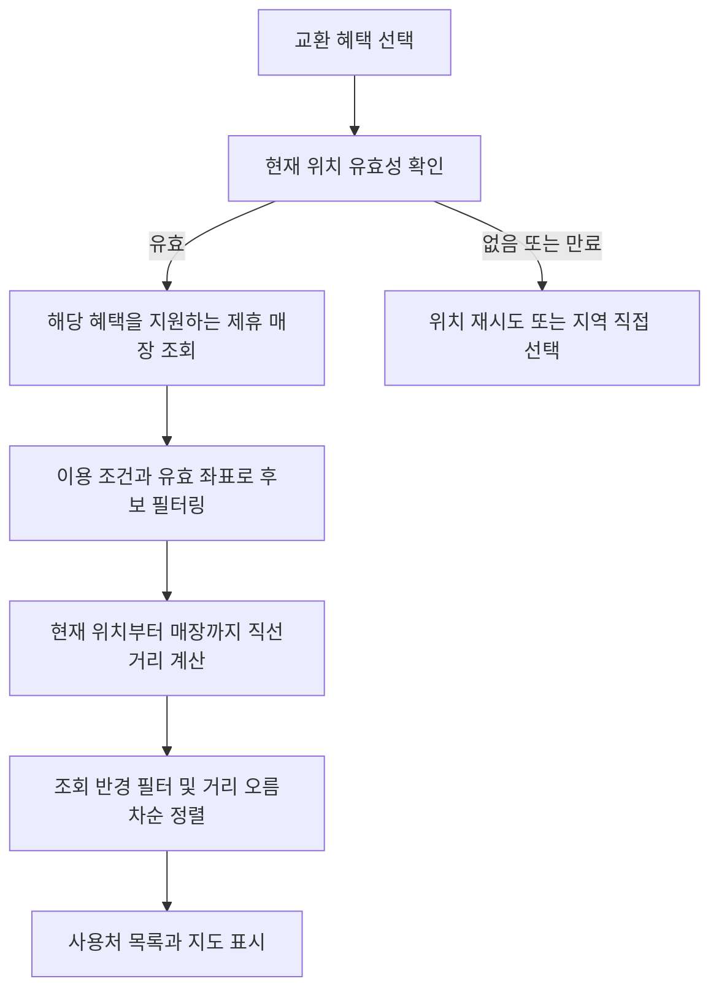

# 현재 위치 기반 마일리지 사용처 탐색 설계

**상태: 설계안·후속 작업. 현재 앱에는 연결돼 있지 않습니다.**

관련: [PR #4](https://github.com/DKU-MUSAZ/h1-score/pull/4), [이번 PR 구현 내용](pr-4-implementation-notes.md).

## 목적

사용자가 선택한 마일리지 혜택을 실제로 이용할 수 있는 제휴 매장을 **내 현재 위치에서 가까운 순서**로 보여줍니다. 내비 목적지 주변의 챌린지 개최지를 고르는 기존 기능과 기준점·대상이 다릅니다.

현재는 로컬 혜택 목록과 시연 교환만 제공하며, 제휴 매장 데이터·위치 공급·검색 API·실제 쿠폰 사용 연동은 미구현입니다.

## 입력과 데이터

| 입력 | 필요한 정보 | 현재 상태 |
| --- | --- | --- |
| 현재 위치 | 위도·경도, 수신 시각, 정확도 또는 유효성 | 사용처 탐색용 공급자 미연결 |
| 선택 혜택 | 와이퍼·에어컨 필터·엔진오일 등 혜택 ID | 로컬 시연 목록 존재 |
| 제휴 매장 | 안정적인 매장 ID, 이름, 좌표, 지원 혜택, 이용 조건 | 데이터 공급 방식 미확정 |
| 조회 범위 | 반경 또는 선택 지역 | 제품 기준 미확정 |

현재 `LiveVehicle.destinationPoint`는 내비 **목적지**이므로 현재 위치처럼 사용하지 않습니다. 현재 위치는 지원되는 차량/플랫폼 위치 공급자와 필요한 권한을 확인한 뒤 별도로 연결해야 합니다.

## 제안 탐색 흐름



1. 사용자가 혜택을 선택하고 주차 상태에서 사용처 화면을 엽니다.
2. 현재 위치의 좌표·수신 시각·정확도를 확인합니다. 누락되거나 오래된 위치를 목적지 좌표로 대신하지 않습니다.
3. 실제로 해당 혜택을 사용할 수 있는 제휴 매장을 조회합니다. 일반 검색에서 발견한 정비소를 곧바로 사용 가능한 매장으로 간주하지 않습니다.
4. 지원 혜택·이용 조건·매장 운영 상태·유효 좌표를 기준으로 후보를 거릅니다.
5. 현재 위치와 각 후보의 직선거리를 계산합니다.
6. 제품에서 정한 반경 안의 후보를 거리순으로 정렬하고, 같은 거리에서는 매장 ID로 순서를 고정합니다.
7. 목록과 지도에 같은 후보를 보여주고, 사용자가 매장을 선택했을 때 이용 조건과 길찾기를 안내합니다.

## 거리 계산과 정렬

기존 [VenueMatching.kt](../../core/src/main/kotlin/ai/musaz/h1score/core/VenueMatching.kt)의 `GeoPoint.distanceMetersTo`는 Haversine 직선거리 계산에 재사용할 수 있습니다. 위도 -90~90, 경도 -180~180과 유한 값 여부를 검사하며 잘못된 좌표는 제외해야 합니다.

제안 순서:

```text
후보 = 제휴 매장 중 선택 혜택과 이용 조건을 충족하는 매장
거리 = 현재 위치.distanceMetersTo(매장 위치)
결과 = 유효 거리 및 조회 반경으로 필터링
       → 거리 오름차순
       → 같은 거리는 매장 ID 오름차순
```

후보 N개에 대해 거리 계산은 O(N), 전체 정렬은 O(N log N)입니다. 표시하는 거리는 **직선거리**이며 자동차 경로 거리나 예상 도착 시간이 아닙니다. 경로 정보는 별도 내비/경로 조회가 연결된 후 구분해서 표시해야 합니다.

## 예외와 화면 상태

| 상황 | 제안 처리 |
| --- | --- |
| 위치 권한 거부·현재 위치 없음 | 재시도와 지역 직접 선택 안내 |
| 오래되거나 정확도가 낮은 위치 | 현재 위치를 다시 확인하도록 안내 |
| 조회 실패 | 실패 상태와 재시도 표시 |
| 반경 내 사용처 없음 | 빈 목록과 반경/지역 변경 안내 |
| 매장 좌표 오류 | 해당 후보 제외 |
| 제휴 조건 미확정 | 실제 사용 가능하다고 표시하지 않음 |

위치 유효기간·정확도 임계값·기본 반경·갱신 이동량은 아직 정하지 않은 제품/SDK 검토 항목입니다. 위치는 사용처 화면이 활성화된 동안 필요한 범위에서 조회하고, 위치가 바뀌거나 사용자가 새로고침할 때 거리를 다시 계산하는 방향을 검토합니다.

## 완료 조건

- [ ] 내비 목적지가 아니라 현재 위치를 기준점으로 사용한다.
- [ ] 선택 혜택을 사용할 수 있는 제휴 매장만 노출한다.
- [ ] 좌표 검증·직선거리·반경 필터·거리 정렬을 구현한다.
- [ ] 같은 거리의 결과 순서는 안정적인 매장 ID로 고정한다.
- [ ] 권한 거부·위치 누락/오래됨·조회 실패·빈 결과를 구분한다.
- [ ] 위치가 달라지면 정렬이 바뀌고, 목적지만 바꿨을 때는 기준점이 바뀌지 않는지 테스트한다.
- [ ] 실제 사용처 탐색과 기존 시연 교환·마일리지 차감 흐름을 구분한다.

## 별도 작업

실제 쿠폰 발급·사용 처리, 제휴 매장 확정, 차종별 이용 조건과 추가금, 서버에서의 잔액·중복 사용 검증은 별도 연동 작업입니다. 이 문서를 추가하는 것으로 해당 기능이 구현되는 것은 아닙니다.
